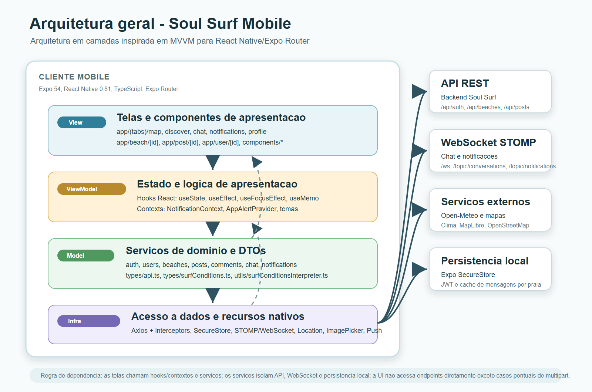
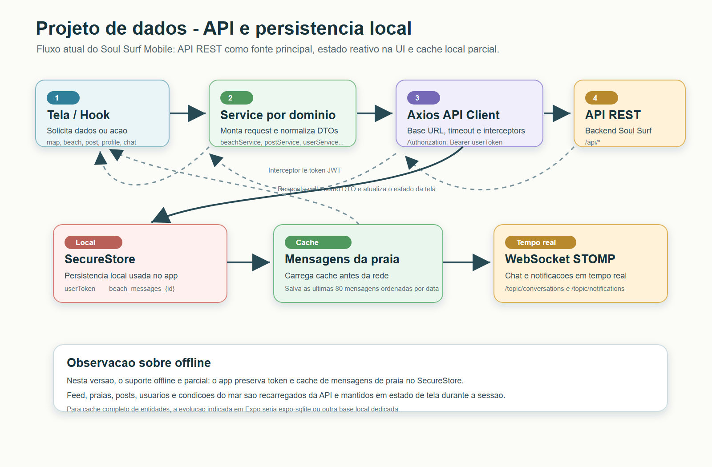
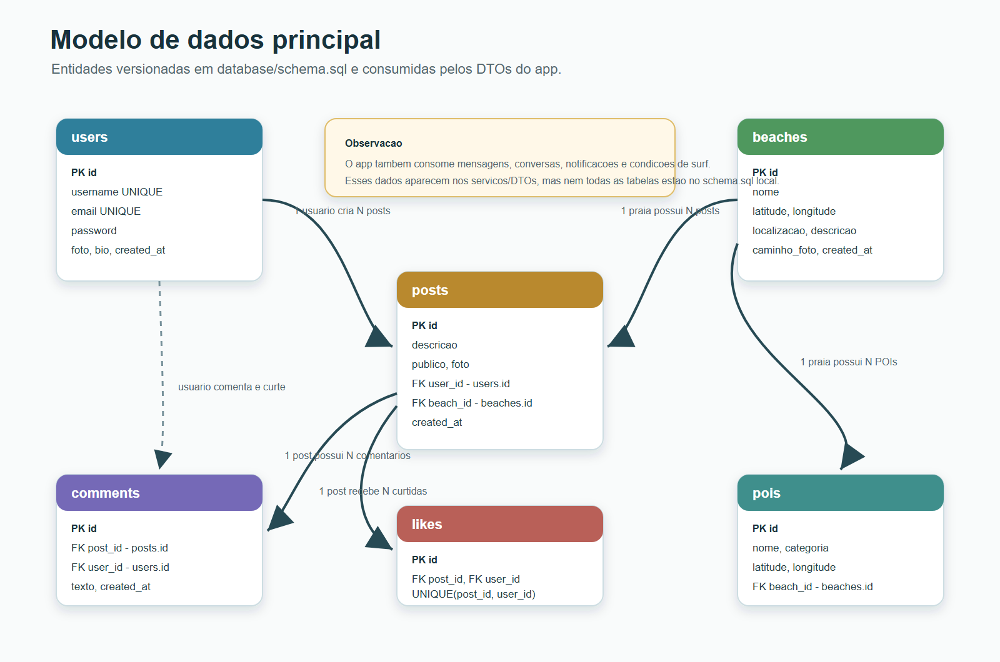
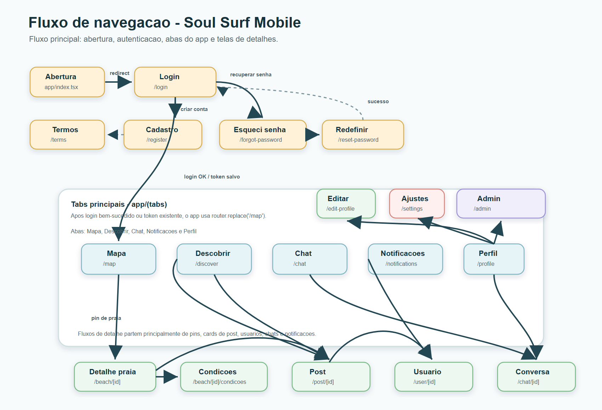

# 3. Projeto e arquitetura do software

## Arquitetura geral

O aplicativo **Soul Surf Mobile** foi desenvolvido em React Native com Expo Router e TypeScript, seguindo uma arquitetura em camadas inspirada no padrao MVVM. No contexto do React Native, a ViewModel nao aparece como uma classe separada: a logica de apresentacao fica distribuida entre hooks, estados locais das telas e contexts globais. Essa organizacao separa a interface, o estado de apresentacao, os servicos de dominio e a infraestrutura de comunicacao.

As camadas sao divididas da seguinte forma:

**View (Apresentacao):** composta pelas telas em `app/`, pelas rotas do Expo Router e pelos componentes reutilizaveis em `components/`. Essa camada exibe dados, captura interacoes do usuario e chama funcoes de estado/servico para executar acoes.

**ViewModel (Estado e logica de apresentacao):** formada por hooks do React (`useState`, `useEffect`, `useFocusEffect`, `useMemo`) e contexts como `NotificationContext` e `AppAlertProvider`. Essa camada controla loading, erros, listas, filtros, contadores, cache em memoria e atualizacoes reativas da UI.

**Model (Dados e dominio):** composta pelos servicos em `services/`, pelos DTOs em `types/` e pelas regras utilitarias em `utils/`. Os servicos concentram o consumo da API REST, WebSocket, upload de imagens, autenticacao, posts, praias, comentarios, usuarios, notificacoes e condicoes de surf.

**Infraestrutura:** composta pelo cliente Axios em `services/api.ts`, interceptors de autenticacao, Expo SecureStore, WebSocket/STOMP e APIs nativas do Expo, como localizacao, notificacoes e selecao de imagens.

## Projeto de dados: integracao com API e persistencia local

A fonte principal de dados do Soul Surf Mobile e a API REST do backend. As telas solicitam dados por meio dos servicos de dominio, que usam o cliente Axios centralizado. Antes de cada requisicao, o interceptor busca o token JWT salvo no SecureStore e injeta o cabecalho `Authorization: Bearer`.

A persistencia local atual e propositalmente enxuta:

- `userToken`: token JWT salvo no Expo SecureStore apos login.
- `beach_messages_{id}`: cache local das ultimas 80 mensagens de uma praia, tambem salvo no SecureStore.
- Estado em memoria: feeds, praias, posts, usuarios, notificacoes e condicoes do mar sao mantidos nos estados das telas durante a sessao e recarregados da API quando necessario.

Essa estrategia garante autenticacao persistente e suporte offline parcial para mensagens ja carregadas de uma praia. O app ainda nao usa Room/SQLite, pois e um projeto Expo/React Native. Para um cache offline completo de entidades como praias, posts e perfis, a evolucao indicada seria adicionar uma base local como `expo-sqlite`.

### Dicionario de dados principal

As principais entidades versionadas no arquivo `database/schema.sql` sao:

| Tabela | Campos principais | Chaves | Descricao |
| --- | --- | --- | --- |
| `users` | `id`, `username`, `email`, `password`, `caminho_foto`, `biografia`, `created_at` | `id` PK, `username` e `email` unique | Armazena os usuarios da plataforma. |
| `beaches` | `id`, `nome`, `latitude`, `longitude`, `localizacao`, `descricao`, `caminho_foto`, `created_at` | `id` PK | Armazena praias e picos de surf exibidos no mapa. |
| `pois` | `id`, `nome`, `categoria`, `latitude`, `longitude`, `descricao`, `telefone`, `beach_id` | `id` PK, `beach_id` FK | Armazena pontos de interesse proximos as praias. |
| `posts` | `id`, `descricao`, `publico`, `foto`, `user_id`, `beach_id`, `created_at` | `id` PK, `user_id` FK, `beach_id` FK | Armazena registros e publicacoes da comunidade. |
| `comments` | `id`, `post_id`, `user_id`, `texto`, `created_at` | `id` PK, `post_id` FK, `user_id` FK | Armazena comentarios de posts. |
| `likes` | `id`, `post_id`, `user_id`, `created_at` | `id` PK, `post_id` FK, `user_id` FK, unique `post_id/user_id` | Controla curtidas sem duplicidade por usuario e post. |

## Consumo da API e fluxo de navegacao

O aplicativo consome a API REST configurada pela variavel `EXPO_PUBLIC_API_URL`. No ambiente local deste projeto, a URL base encontrada e:

`http://147.15.58.134:8080`

A documentacao oficial OpenAPI/Swagger do backend nao esta versionada neste repositorio mobile. Quando o link oficial estiver publicado, ele deve ser inserido nesta secao como a URL de documentacao da API.

Principais grupos de endpoints consumidos pelo app:

- Autenticacao: `/api/auth/login`, `/api/auth/signup`, `/api/auth/forgot-password`, `/api/auth/reset-password`.
- Praias e POIs: `/api/beaches`, `/api/beaches/{id}`, `/api/pois`.
- Posts e comentarios: `/api/posts/home`, `/api/posts/{id}`, `/api/posts/{id}/comments`.
- Usuarios: `/api/users/me`, `/api/users/{id}`, `/api/users/search`, `/api/users/{id}/follow`.
- Chat e notificacoes: `/api/chat/conversations`, `/api/notifications`, WebSocket `/ws`.
- Condicoes de surf: `/api/weather/surf-conditions` e servico externo Open-Meteo.

O fluxo principal inicia em `app/index.tsx`, que redireciona para a tela de login. Se o usuario ja possui token salvo, ou apos login bem-sucedido, o app direciona para a aba Mapa (`/map`). A partir dela, o usuario acessa detalhes de uma praia, condicoes do mar, posts, usuarios e conversas.

